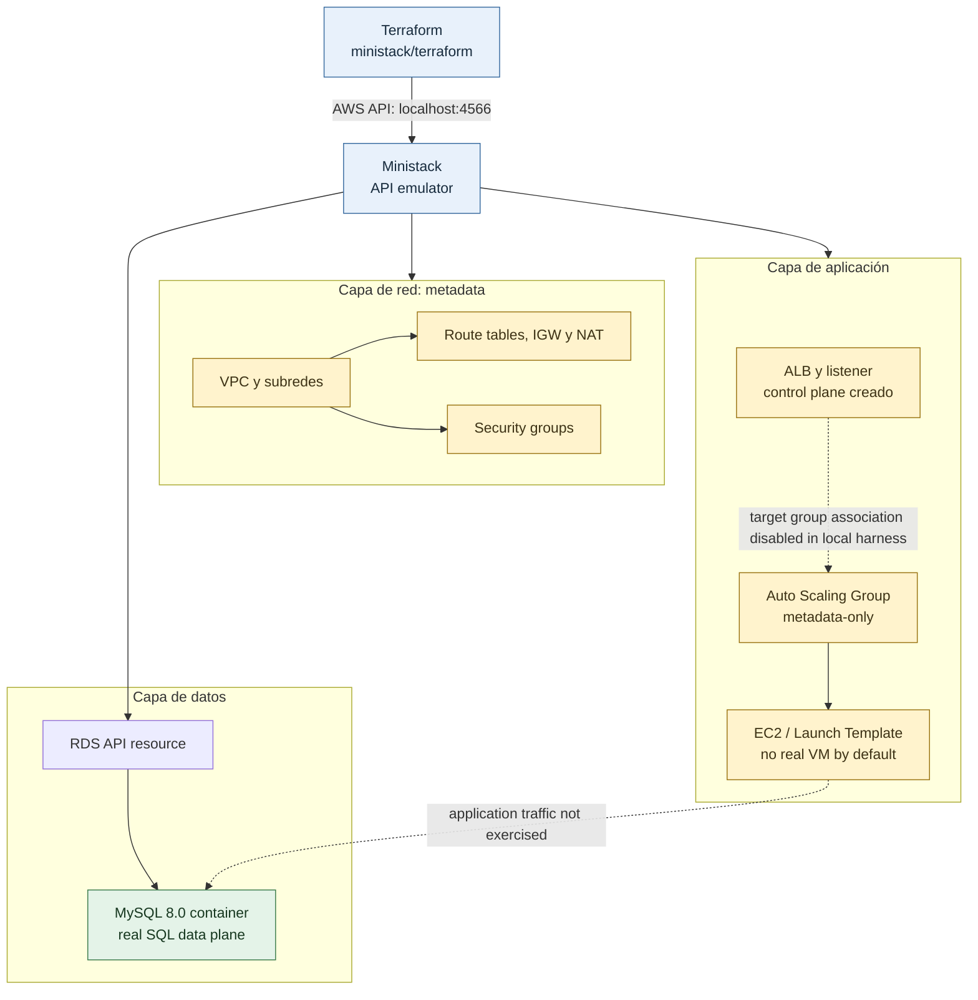

# Arquitectura AWS de tres capas con Terraform

Este proyecto despliega en AWS una arquitectura de tres capas mediante Terraform. Incluye una red VPC, un balanceador de carga, un grupo de instancias EC2 con escalado automático y una base de datos MySQL administrada en Amazon RDS.

## Arquitectura desplegada

La configuración predeterminada utiliza la región `us-west-2` y dos zonas de disponibilidad (`us-west-2a` y `us-west-2b`):

- **Red:** VPC `10.0.0.0/16`, dos subredes públicas, dos subredes privadas para la aplicación y dos subredes privadas para la base de datos.
- **Entrada y salida:** un Internet Gateway, un Application Load Balancer (ALB) en las subredes públicas y un NAT Gateway para el tráfico saliente de las subredes privadas.
- **Aplicación:** un Auto Scaling Group en las subredes privadas, con capacidad inicial deseada de dos instancias EC2 y límites predeterminados de una a tres. El grupo reemplaza instancias que el ALB marque como no saludables y escala según un objetivo predeterminado de CPU promedio del 60 %. Las instancias ejecutan Apache HTTP, requieren IMDSv2 y usan volúmenes raíz cifrados.
- **Datos:** una instancia Amazon RDS MySQL 8.0, no accesible públicamente, con almacenamiento cifrado y siete días de retención de backups automáticos por defecto. RDS administra la contraseña maestra mediante AWS Secrets Manager. La capa de aplicación accede a MySQL mediante su security group. La configuración actual no habilita despliegue Multi-AZ.

El tráfico web sigue el recorrido `Internet → ALB → EC2 → RDS`. Las instancias EC2 utilizan el NAT Gateway para las conexiones salientes.

## Estructura del proyecto

```
aws-terraform-3tier-architecture/
├── main.tf                 # Configuración principal de módulos
├── variables.tf            # Variables de entrada
├── outputs.tf              # Salidas del proyecto
├── providers.tf            # Configuración de proveedores
├── backend.tf              # Configuración de backend (estado Terraform)
├── README.md               # Documentación del proyecto
├── ministack/               # Imagen local del emulador AWS Ministack
│   ├── Dockerfile
│   ├── .dockerignore
│   └── terraform/           # Root module aislado para pruebas locales
│       ├── main.tf
│       ├── outputs.tf
│       └── .terraform.lock.hcl
└── modules/                # Módulos de infraestructura
    ├── vpc/                # Módulo de VPC y red
    │   ├── main.tf
    │   ├── variables.tf
    │   └── outputs.tf
    ├── ec2_cluster/        # Módulo de clúster EC2
    │   ├── main.tf
    │   ├── variables.tf
    │   └── outputs.tf
    └── rds_database/       # Módulo de base de datos RDS
        ├── main.tf
        ├── variables.tf
        └── outputs.tf
```

## Requisitos

1. Terraform `>= 1.5.0`.
2. Docker Engine para la prueba local con Ministack.
3. Una cuenta de AWS y credenciales disponibles para los despliegues reales en AWS (por perfil, variables de entorno o un rol). No se necesitan para el root de prueba local.

## Variables de entrada

| Variable | Descripción | Tipo | Valor por Defecto |
|----------|-------------|------|-------------------|
| `aws_region` | Región de AWS | `string` | `us-west-2` |
| `project_name` | Identificador usado en nombres de recursos | `string` | `portfolio` |
| `environment` | Nombre del entorno de despliegue | `string` | `dev` |
| `common_tags` | Tags adicionales para recursos de cómputo y base de datos | `map(string)` | `{}` |
| `private_app_subnet_cidr` | Rangos CIDR de las subredes privadas de aplicación | `list(string)` | `["10.0.11.0/24", "10.0.12.0/24"]` |
| `instance_type` | Tipo de instancia EC2 | `string` | `t2.micro` |
| `asg_min_size` | Cantidad mínima de instancias de aplicación | `number` | `1` |
| `asg_desired_capacity` | Capacidad inicial deseada | `number` | `2` |
| `asg_max_size` | Cantidad máxima de instancias de aplicación | `number` | `3` |
| `asg_cpu_target_value` | Objetivo de CPU promedio para escalado | `number` | `60` |
| `db_name` | Nombre de la base de datos | `string` | `portfoliodb` |
| `db_username` | Usuario administrador de la base de datos | `string` | `admin` |
| `db_engine_version` | Versión del motor MySQL | `string` | `8.0` |
| `db_instance_class` | Clase de instancia RDS | `string` | `db.t3.micro` |
| `db_allocated_storage` | Almacenamiento inicial de RDS en GiB | `number` | `20` |
| `db_backup_retention_days` | Días de retención de backups automáticos | `number` | `7` |
| `db_storage_encrypted` | Activa el cifrado del almacenamiento RDS | `bool` | `true` |
| `db_apply_immediately` | Aplica inmediatamente modificaciones de RDS | `bool` | `false` |

## Módulos

### 1. Módulo VPC (`modules/vpc`)
Crea la VPC, subredes públicas y privadas en dos zonas, gateways, tablas de rutas y el grupo de subredes de RDS.

### 2. Módulo EC2 Cluster (`modules/ec2_cluster`)
Implementa el ALB, sus reglas de acceso, un Auto Scaling Group con escalado por CPU y salud integrada con el ALB, y las instancias EC2 con Amazon Linux 2023 y Apache HTTP. El módulo acepta parámetros para proyecto, entorno, tags, tipo de instancia y capacidad.

### 3. Módulo RDS Database (`modules/rds_database`)
Implementa una instancia RDS MySQL 8.0 no pública y un grupo de seguridad que permite conexiones desde el grupo de seguridad de la capa de aplicación.

## Entorno local con Ministack

El directorio `ministack/` contiene un Dockerfile derivado de la imagen oficial `ministackorg/ministack:1.5.28`. La imagen conserva el arranque del proveedor, expone el gateway en el puerto `4566` y comprueba su estado mediante `/_ministack/health`. La versión queda fijada para que las pruebas locales sean reproducibles.

El directorio `ministack/terraform/` es un root module separado que reutiliza los módulos del proyecto, pero fija todos los endpoints del provider AWS a `http://localhost:4566` y usa credenciales ficticias. Ejecutar Terraform desde allí evita usar el provider AWS de la raíz, que apunta a AWS.

### Prueba local

Requisitos: Docker Engine y Terraform `>= 1.5.0`.

1. Construir la imagen local:

```bash
docker build -t aws-terraform-3tier-ministack:local ./ministack
```

2. Iniciar Ministack. El montaje del socket Docker es necesario para que RDS cree el contenedor MySQL; concede al contenedor control sobre el daemon local, por lo que debe usarse solo en una máquina de desarrollo confiable.

```bash
docker run --rm -d \
  --name portfolio-ministack-local \
  -p 127.0.0.1:4566:4566 \
  -v /var/run/docker.sock:/var/run/docker.sock \
  -e MINISTACK_RDS_PUBLIC_ENDPOINT=1 \
  -e MINISTACK_HOST=127.0.0.1 \
  aws-terraform-3tier-ministack:local
```

3. Esperar a que el gateway esté disponible:

```bash
curl --fail http://127.0.0.1:4566/_ministack/health
```

4. Inicializar, planificar y aplicar desde el root local aislado:

```bash
terraform -chdir=ministack/terraform init
terraform -chdir=ministack/terraform plan
terraform -chdir=ministack/terraform apply
terraform -chdir=ministack/terraform output
```

5. Comprobar el MySQL real que Ministack creó. La consulta usa las credenciales dentro del contenedor, sin imprimir la contraseña:

```bash
RDS_CONTAINER=$(docker ps --filter 'name=ministack-rds-' --format '{{.Names}}' | head -n 1)
docker exec "$RDS_CONTAINER" sh -c 'MYSQL_PWD="$MYSQL_PASSWORD" mysql --protocol=TCP -h127.0.0.1 -u"$MYSQL_USER" -D "$MYSQL_DATABASE" -Nse "SELECT DATABASE(), VERSION(), 1"'
```

6. Eliminar los recursos del state local y detener el emulador:

```bash
terraform -chdir=ministack/terraform destroy
docker stop portfolio-ministack-local
```

El state y los planes Terraform locales están cubiertos por `.gitignore`; `.dockerignore` evita incluir el root de prueba, el state y los planes en el contexto de build.

### Diagrama local



### Resultado observado

En la ejecución local de referencia, el state llegó a contener 29 recursos y el apply final informó `No changes` (`0 added, 0 changed, 0 destroyed`). Incluye VPC, subredes, tablas y asociaciones de rutas, security groups, ALB/target group/listener, launch template, ASG, política de escalado, DB subnet group y RDS. El endpoint informado fue `127.0.0.1:15432`, cuyo puerto TCP aceptó conexiones; la consulta al contenedor MySQL devolvió `localdb`, versión `8.0.46` y `1`.

### Salvedades de la emulación

- La VPC, subredes, NAT, rutas y security groups son recursos de control plane: Ministack no enruta paquetes ni hace cumplir las reglas de red.
- EC2 y el ASG son metadata-only en esta configuración. Se usa `ami-00000001` solo para que el Launch Template pueda crearse; no se inicia una VM ni se ejecuta el user data.
- El Auto Scaling API de Ministack no implementa `AttachLoadBalancerTargetGroups`; por eso `attach_target_group_arns = false` solo en el harness local. El ALB y el listener se crean, pero no hay target registrado ni flujo ALB→EC2 que probar. No se validó una respuesta HTTP funcional del ALB. Las comprobaciones de salud no se ejecutan y las políticas de escalado quedan almacenadas, no disparadas.
- RDS sí inicia un MySQL real, pero Ministack no devolvió `master_user_secret` al usar `manage_master_user_password = true`; por eso el ARN del secreto no aparece en los outputs locales. La prueba SQL anterior usa credenciales internas del contenedor y no valida Secrets Manager ni la entrega de credenciales a la aplicación.
- El output del ALB es metadata emulada y no se debe tomar como una URL pública funcional.
- La contraseña maestra y otras capacidades de RDS en AWS siguen el comportamiento real del provider; el test local no demuestra cifrado de disco, backups, IAM, rutas o seguridad de AWS.

## Uso

RDS genera y administra la contraseña maestra mediante AWS Secrets Manager. El principal de AWS usado por Terraform necesita permisos para administrar RDS y el secreto; los usuarios que consulten las credenciales necesitan permisos de lectura sobre ese secreto.

### 1. Inicializar Terraform
```bash
terraform init
```

### 2. Planificar la Infraestructura
```bash
terraform plan
```

### 3. Aplicar la Infraestructura
```bash
terraform apply
```

### 4. Verificar Outputs
Después de aplicar, Terraform mostrará la URL del ALB, el endpoint de la base de datos y el ARN del secreto de Secrets Manager. El output revela el ARN, no el contenido del secreto:
```bash
application_url = http://portfolio-dev-alb-123456789.us-west-2.elb.amazonaws.com
database_endpoint = portfolio-dev-db.abcdefgh.us-west-2.rds.amazonaws.com:3306
database_secret_arn = arn:aws:secretsmanager:us-west-2:123456789012:secret:portfolio-dev-db-example
```

### 5. Destruir la Infraestructura
```bash
terraform destroy
```

## Acceso y conectividad

El ALB acepta tráfico HTTP por el puerto 80 y las instancias EC2 reciben tráfico HTTP solo desde el grupo de seguridad del ALB. Para mantener este template simple, la salida de los security groups del ALB y de EC2 permite todos los destinos; en un despliegue con destinos definidos, restringe esas reglas al mínimo necesario. La base de datos acepta conexiones MySQL desde el grupo de seguridad de EC2. AWS Secrets Manager administra la contraseña maestra de RDS; Terraform no recibe su valor. El estado local sigue conteniendo metadatos de infraestructura y debe protegerse; para uso compartido, configura un backend remoto con cifrado y controles de acceso.

## Costos

El coste depende de la región, el tiempo de ejecución, el tráfico y los precios vigentes de AWS. El NAT Gateway, el ALB, las instancias EC2 y RDS generan cargos; consulta AWS Pricing Calculator antes de desplegar.

## Personalización

Para cambiar la región, define `aws_region` en un archivo de variables local o mediante `TF_VAR_aws_region`.

Para ajustar el tipo de instancia EC2, define `instance_type`. Los valores de escalado de la aplicación se configuran con `asg_min_size`, `asg_desired_capacity`, `asg_max_size` y `asg_cpu_target_value`. Para RDS, define `db_engine_version`, `db_instance_class`, `db_allocated_storage`, `db_backup_retention_days`, `db_storage_encrypted` y `db_apply_immediately`.

Si agregas subredes de aplicación, actualiza también las zonas de disponibilidad en `modules/vpc/variables.tf` para que ambas listas tengan la misma longitud.

```hcl
variable "private_app_subnet_cidr" {
  default = ["10.0.11.0/24", "10.0.12.0/24", "10.0.13.0/24"]
}
```

## Solución de problemas

### Credenciales de AWS no configuradas
```bash
aws sts get-caller-identity
```

## Nota

Este repositorio es un template demostrativo. La configuración conserva `skip_final_snapshot = true`: al destruir RDS, la instancia y sus datos se eliminan sin crear un snapshot final. Haz una copia independiente de cualquier dato que necesites conservar. Antes de aplicar estos cambios sobre una instancia existente, revisa el plan: cambiar su identificador o habilitar cifrado en una instancia previamente no cifrada puede implicar reemplazo o migración. Antes de utilizarlo en un entorno productivo, configura HTTPS en el ALB con un certificado ACM y redirige HTTP a HTTPS. Revisa también los requisitos de disponibilidad, copias de seguridad, monitoreo y acceso de la aplicación. La configuración actual usa un único NAT Gateway y no habilita RDS Multi-AZ; los costes reales dependen del uso y de los precios vigentes de AWS.